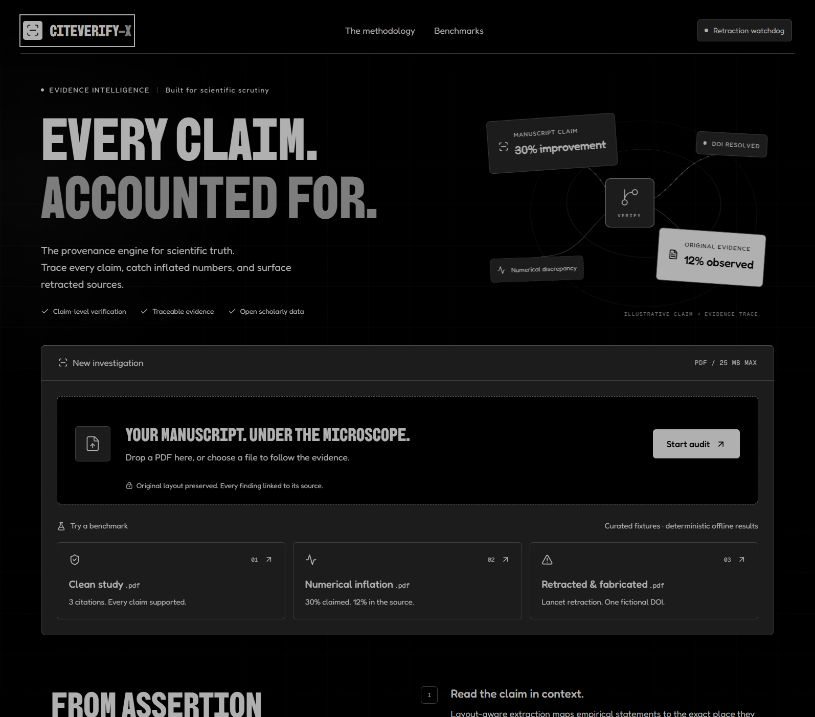

# CiteVerify-X

**Every claim accounted for.** A research prototype for tracing manuscript claims to their cited evidence, checking numerical discrepancies, and inspecting citation integrity.



## What it does

- Parses text-layer PDFs and retains page and word coordinates.
- Extracts empirical claims, inline citations, and bibliography links.
- Resolves scholarly records with OpenAlex and Crossref, checks retraction records, and locates open-access sources through Unpaywall.
- Retrieves candidate evidence and combines NLI classification with deterministic numerical checks.
- Provides a Next.js evidence workbench, asynchronous FastAPI progress, and an exportable audit certificate.
- Includes three deterministic offline benchmarks: supported citations, numerical inflation, and retracted or fabricated citations.

## Quick start

Already using the [hosted frontend](https://citeverify-x.vercel.app)? Deploy the
Phase 4/5 backend with [Deploy to Render](https://render.com/deploy?repo=https://github.com/Rudra-Pratap-Singh-07/citeverify-x),
then follow [the Vercel connection guide](docs/DEPLOYMENT.md). The default cloud
configuration runs the synthetic demo; live checks require the configuration
described in that guide.

The project's backend address is [citeverify-x.onrender.com](https://citeverify-x.onrender.com/docs)
with a [health endpoint](https://citeverify-x.onrender.com/api/v1/health).

Requires Python 3.11, Node.js, and pnpm. The frontend regression tests use Node.js 24 native TypeScript support.

```powershell
py -3.11 -m venv .venv
.\.venv\Scripts\Activate.ps1
python -m pip install -e ".[api,test,verification]"
pnpm --dir frontend install --frozen-lockfile
python run_demo.py
```

Open **http://127.0.0.1:3001** and choose a benchmark. The demo runner uses deterministic fixtures and starts the API on port 8000. Stop any existing servers using those ports before starting it.

For live scholarly lookups, run the services separately without `DEMO_MODE=true`:

```powershell
python -m uvicorn api.server:app --host 127.0.0.1 --port 8000
# In another terminal:
pnpm --dir frontend dev --port 3001
```

Set `UNPAYWALL_EMAIL` and, where required, `OPENALEX_API_KEY` in your process environment. Local NLI and embedding models download on first use. An optional Groq backend requires `GROQ_API_KEY`. Never commit real credentials. Frontend configuration is documented in `frontend/.env.example`.

## Project structure

| Directory | Purpose |
| --- | --- |
| `src/parser` | PDF ingestion and citation graph |
| `src/resolvers` | Scholarly metadata, retractions, caching |
| `src/verification` | Retrieval, NLI, numerical audit |
| `src/api` | Asynchronous jobs, reports, certificate export |
| `frontend/app` | Next.js launchpad and audit routes |
| `frontend/components` | Linked manuscript and evidence viewer |
| `tests/benchmarks` | Three synthetic benchmark documents |
| `data/demo_fixtures.json` | Offline scholarly responses |
| `presentations` | Project explanation and presentation source |

## Validation

```powershell
python -m pytest -q
pnpm --dir frontend test
pnpm --dir frontend build
```

See [Phase 4](PHASE4.md) for API integration and [Phase 5](PHASE5.md) for the offline demo and benchmark contracts.

## Scope and interpretation

This prototype supports English text-layer PDFs. DOCX, OCR, full source-PDF retrieval, and exhaustive claim extraction remain outside the implemented coverage. Evidence may be limited to abstracts or cached text.

Confidence scores are uncalibrated. Benchmarks use synthetic sources and deterministic inference and do not establish real-world verification accuracy. The certificate includes a SHA-256 content digest, not a signed attestation. Human review is required for consequential conclusions.

The local service has no production authentication layer. Uploaded manuscripts, task state, caches, credentials, and model environments are excluded from this repository.

## Design assets

The interface uses the project's five-stop grayscale palette, BBH Bogle headings, and Fredoka body text. Font licenses are included in `frontend/app/fonts`. Geist Mono is used for precise identifiers and numerical data.
